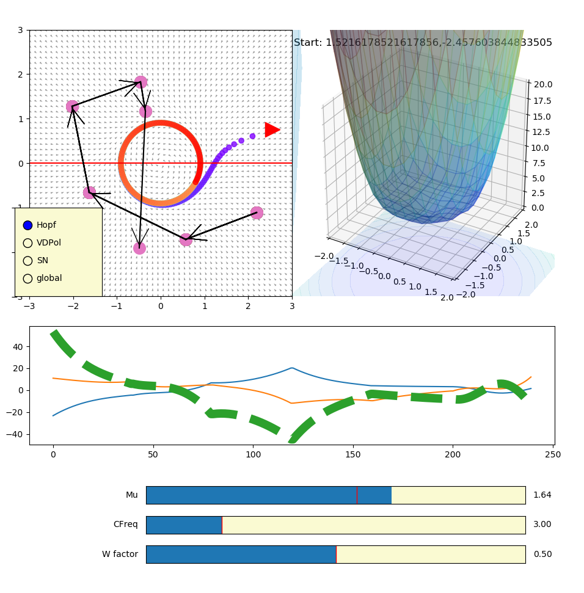

# Dynamical Network

## Overview
This is a small library to study low-dimensional dynamical systems using intuitive UI and [autoLie](https://github.com/virati/autoLie)

## GPU flow viewer

`uv run streamlit run app/streamlit_app.py` opens the app with a **GPU view**
tab: the renderer from
[attractor-screensaver](https://github.com/virati/attractor-screensaver),
integrating a thousand trajectories on the GPU and drawing their trails.

- **What it shows** (sidebar, *GPU view*): the current 2-D system, live with
  the sliders; any 3-D [dysts](https://github.com/williamgilpin/dysts) flow;
  or the **Lie bracket** of any two, [f, g] = (∂f/∂x) g − (∂g/∂x) f,
  computed with [autoLie](https://github.com/virati/autoLie).
- **3-D ⟷ 2-D:** the *3D / 2D* buttons (or `F`) warp continuously between
  the orbiting 3-D view and a flat plot of two state axes. *x–y / x–z / y–z*
  (or `1 2 3`) changes the plane; when flat it rises through 3-D and comes
  back down, so you can follow which axis went where.
- **Slicing:** *Slice* (or `S`) keeps only the trails inside a slab along the
  third axis; drag *at* and *thickness* to sweep a cross-section through the
  flow, in either view.
- **Talking to it:** the chat agent's context includes the equations and
  behaviour of whatever the GPU view is showing.

Each flow goes through `vizdyn.gpu`: its right-hand side is traced to sympy,
printed as GLSL with `autolie.symbolics.codegen`, checked against autoLie's
autograd operators on the trajectory (the bracket against
`lie_lib.bracket_field`), and run through the shader's own RK4 to choose a
time step, a seed and a view. A 2-D system is lifted with z' = −z, so it
settles into the plane and opens flat. Many brackets have no attractor (two
constant-divergence flows bracket to a volume-preserving field); those are
shown near the seed and labelled.

The renderer sources live in `web/src`; after changing them run
`node web/build.mjs` to rebuild `src/vizdyn/frontend/webgl/viewer.html`.

## Dynamical System Viewer
Right now, the most complete portion of this repo is the Dynamical System Viewer (interactive_flow_field.py). Below is a quick visual overview of what this tool does.

The viewer itself has several components - phase portrait, pseudo-energy landscape, and time series.

For an interactive notebook version of the above that can run in your browser, head to [colab](https://colab.research.google.com/drive/101JEF-nCyKaMFq1CRGgpca4oebaLh7bO?usp=sharing)

### Phase space
The top left consists of a phase-space representation of our dynamical system and an example trajectory from a given initial state.

Dynamics selection amongst a set of pre-defined systems can be done using the checkbox.

### Potential-like function
On the top right is a potential-like function that computes the gradient of a the magnitude of change.

It must be mentioned that this is not the potential function itself as such a function may not be exist for all systems. Indeed, for oscillatory systems a potential function does not exist as flows occur down a potential gradient but an oscillatory system has a periodicity in its state trajectory over time that indicates it cannot always be going down a gradient.

## Control signal
A relatively new feature is in the identification of a control system for the implementation of an arbitrary piecewise linear trajectory. Left clicking in the phase-portrait representation at various locations traces out a desired trajectory. The required control signal input to implement that trajectory is then displayed in the middle timeseries panel as a dotted green line.

This is an in-development feature of the UI but will be expanded on to enable arbitrary control-affine coupling into the dynamics of the system. In addition, the control will be abstracted into the backend library to enable integration with autoLie and broader efforts to identify optimal control strategies for simplified dynamical systems in a way that is intuitive to the visual/clinical learners.
